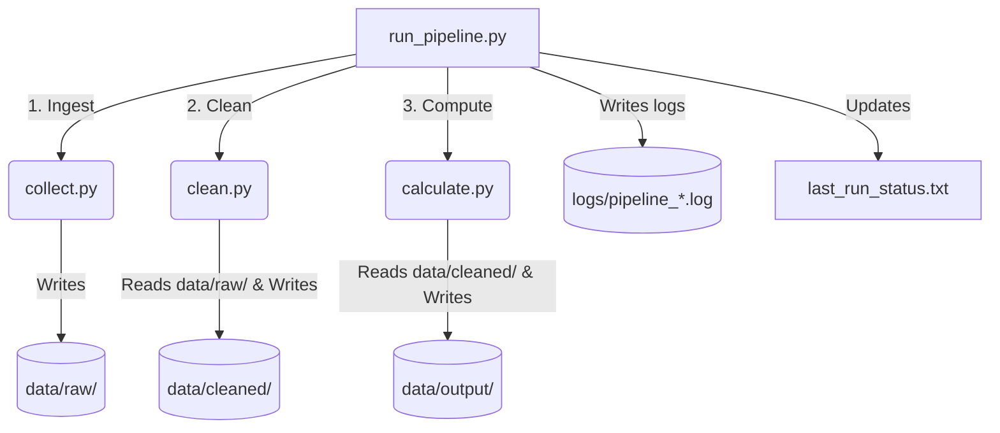
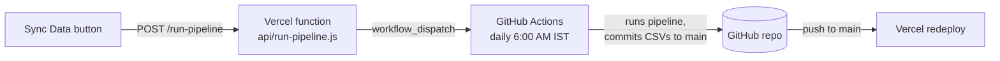

# Mutual Fund Dashboard

[](https://github.com/krishyadav-dev/Mutual_Fund_Dashboard/actions/workflows/sync_data.yml)
[](https://mutual-fund-dashboard-release.vercel.app)


[](LICENSE)

**Live site:** https://mutual-fund-dashboard-release.vercel.app

An end-to-end analytics project for Indian mutual funds. A Python ETL pipeline collects NAVs, AUM, expense ratios and ratings for **48 Direct-Growth funds**. It cleans and normalises the data and computes performance and risk metrics: CAGR, Sharpe, Sortino, drawdowns, alpha/beta and rolling returns. The results feed an interactive web dashboard and a Power BI report.

We refactored this codebase from an experimental Jupyter notebook into a clean, modular set of Python scripts that are reliable enough to run on a daily schedule.

---

## Fund Universe

The universe covers the core SEBI categories. In each category it holds the largest funds by AUM that have at least 3 years of NAV history.

| Group | Categories |
|---|---|
| Equity (29) | Large Cap, Flexi Cap, Mid Cap, Small Cap, Large & Mid Cap, Multi Cap, Focused, Value / Contra, ELSS |
| Hybrid (6) | Aggressive Hybrid, Balanced Advantage |
| Debt (8) | Short Duration, Corporate Bond, Liquid, Gilt |
| Index / Others (5) | Nifty 50, Nifty Next 50 and Sensex index funds |

Each fund is measured against a benchmark that suits its category. Each index fund is measured against the index it tracks.

---

## How It Works

The data pipeline runs in three sequential stages orchestrated by a master controller:



1. **Ingest (`collect.py`)**: Collects data from four sources and writes it to `data/raw/`:
   - NAV history and scheme details from [mfapi.in](https://www.mfapi.in)
   - daily NAVs and monthly AUM disclosures from AMFI
   - AUM, expense ratios and Morningstar ratings from Kuvera
   - index benchmarks from `yfinance`

   Each fund's mfapi data is cached during a run, so it is downloaded once rather than four times.
2. **Clean & Validate (`clean.py`)**: Validates the schemas, handles missing values, filters duplicates or faulty records, and runs integrity diagnostics. It also maps AMFI's category labels to 4 broad groups and the standard SEBI sub-categories. Saves cleaned data to `data/cleaned/`.
3. **Calculate (`calculate.py`)**: Computes core metrics: CAGR, Sharpe and Sortino ratios, volatility, max drawdown, alpha/beta and return per unit of cost. It combines them into a composite score, then ranks each fund across the universe and within its category. Rolling 1-year returns are saved as one point per fund per week. Saves final results to `data/output/`.

`run_pipeline.py` is the main entry point that ties these stages together, manages preflight checks, captures log files, and handles retries.

### Outputs (`data/output/`)

| File | Contents |
|---|---|
| `fund_metrics.csv` | One row per fund: category, benchmark, AUM, expense ratio, stars, returns, risk metrics, composite score and ranks |
| `rolling_returns.csv` | Weekly rolling 1-year return per fund |
| `fund_aum_history.csv` | Monthly AUM history per fund |

---

## The Dashboard

The dashboard is a static web page (`index.html`, `index.css`, `index.js`) that reads the CSVs in `data/output/`. It uses Chart.js and has light and dark themes. It has five tabs:

- **Screener**: a sortable, filterable table of all funds with category badges, star ratings and key metrics.
- **Visuals**: a risk-return scatter, where bubble size shows AUM, and a rolling-returns chart for searching and comparing up to 5 funds.
- **Compare**: side-by-side comparison of selected funds.
- **Power BI**: the embedded Power BI report, whose source is `Mutual Fund Dashboard.pbip`.
- **Deep Dive**: a single-fund view, with funds grouped by category in the selector.

To run it locally:
```bash
python run_dashboard.py
```
This serves the dashboard at `http://localhost:8000` and opens it in your browser. When running locally, the **Sync Data** button runs the pipeline on your machine.

---

## Deployment and Automation



- **Daily sync** (`.github/workflows/sync_data.yml`): runs the full pipeline every day at 00:30 UTC (6:00 AM IST) and commits the refreshed CSVs to `main`. The badge at the top shows its latest status.
- **Hosting**: the dashboard is deployed on Vercel. Every push to `main` triggers a redeploy, so the site always shows the latest data.
- **On-demand sync**: on the live site, the **Sync Data** button calls a Vercel serverless function (`api/run-pipeline.js`), which triggers the same GitHub Actions workflow.
  - The function needs a `GH_DISPATCH_TOKEN` environment variable in Vercel.
  - Use a fine-grained GitHub token for this repo with *Actions: Read and write* permission.

### Directory Layout

```text
Mutual_Fund_Dashboard/
├── collect.py             # Stage 1: Ingestion
├── clean.py               # Stage 2: Cleaning & validation
├── calculate.py           # Stage 3: KPI calculation
├── run_pipeline.py        # Pipeline orchestrator & runner
├── requirements.txt       # Python dependencies
│
├── index.html             # Dashboard markup
├── index.css              # Dashboard styles (light & dark themes)
├── index.js               # Dashboard logic and charts
├── run_dashboard.py       # Local server for the dashboard
├── api/run-pipeline.js    # Vercel function behind the Sync Data button
├── vercel.json            # Vercel routing
│
├── .github/workflows/     # Daily data sync workflow
├── Mutual Fund Dashboard.pbip  # Power BI project
├── schedule_task.ps1      # Optional Windows Task Scheduler setup
│
├── last_run_status.txt    # Summary of the most recent run (created on execution)
├── logs/                  # Text logs saved for debugging
└── data/
    ├── raw/               # Output from collect.py
    ├── cleaned/           # Output from clean.py
    └── output/            # Final CSVs for the dashboard and Power BI
```

See [ARCHITECTURE.md](ARCHITECTURE.md) for a file-by-file guide.

---

## Getting Started

### Prerequisites
Make sure you have **Python 3.10+** and a package manager installed. We recommend setting up a virtual environment or Conda env:

```bash
# Create and activate environment
conda create -n mutual_fund_dashboard python=3.11 -y
conda activate mutual_fund_dashboard

# Install dependencies
pip install -r requirements.txt
```

### Running the Pipeline

To run a full update (Ingest → Clean → Calculate):
```bash
python run_pipeline.py
```

To run a single stage for testing (without re-scraping or recalculating everything):
```bash
python run_pipeline.py --stage clean
```

To run preflight environment and dependency checks (without executing any pipeline code):
```bash
python run_pipeline.py --dry-run
```

By default, if a stage fails (e.g. due to a network timeout during ingestion), the runner will retry it up to 2 times after a short delay. You can disable this behavior during debugging:
```bash
python run_pipeline.py --no-retry
```

---

## Operational Details

- **Windows Console Safety**: Windows terminals using `CP1252` encoding typically crash with `UnicodeEncodeError` when scripts print special symbols (like checkmarks or arrows). The logging in this repository is explicitly restricted to safe ASCII characters (`[OK]`, `[FAIL]`, `[WARN]`, `->`) to guarantee robust terminal execution.
- **UTF-8 Override**: The pipeline dynamically injects `PYTHONIOENCODING=utf-8` to child processes to ensure standard libraries parsing external sources do not trigger encoding failures.
- **Monitoring status**: Each execution updates `last_run_status.txt` with a single line (e.g., `SUCCESS | 2026-05-21 02:07:46 | Duration: 1m 12s`). You can use this file to trigger alerts or verify updates before refreshing dashboards.

---

## Local Scheduling (Windows Task Scheduler)

The GitHub Actions workflow already keeps the live site up to date. If you also want to refresh a local copy every day, we provide a Windows Task Scheduler integration. This triggers `run_pipeline.py` daily inside its dedicated Miniconda environment.

### 1. Register / Update the Daily Task
To register the task to run automatically every day at **6:00 AM**, open a PowerShell terminal and run:
```powershell
powershell -ExecutionPolicy Bypass -File .\schedule_task.ps1 -Action Register
```
This sets up the task with robust options:
* **Wake to run**: Wakes up your machine if it's sleeping at 6:00 AM.
* **Network requirement**: Only executes if there is active internet connectivity.
* **Missed start execution**: Automatically runs the pipeline as soon as possible if the computer was turned off at 6:00 AM.

### 2. Control & Manage the Task
You can easily control, test, or disable the task at any time using the same manager script:

* **Turn OFF the Scheduler (Temporarily Disable)**:
  ```powershell
  powershell -ExecutionPolicy Bypass -File .\schedule_task.ps1 -Action Disable
  ```
* **Turn ON the Scheduler (Enable again)**:
  ```powershell
  powershell -ExecutionPolicy Bypass -File .\schedule_task.ps1 -Action Enable
  ```
* **Trigger a Test Run (Force Run in Background)**:
  ```powershell
  powershell -ExecutionPolicy Bypass -File .\schedule_task.ps1 -Action Run
  ```
* **Check Schedule & Last Run Status**:
  ```powershell
  powershell -ExecutionPolicy Bypass -File .\schedule_task.ps1 -Action Status
  ```
* **Completely Delete/Remove the Task**:
  ```powershell
  powershell -ExecutionPolicy Bypass -File .\schedule_task.ps1 -Action Unregister
  ```

